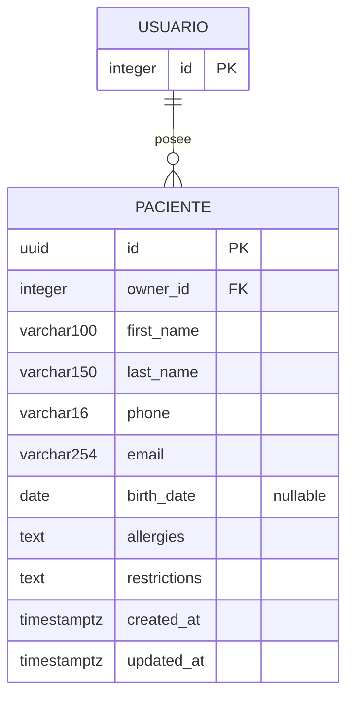

# Modelo lógico de datos — Sprint 1

Responsable: Diana. Acuerdos confirmados en PR #9; revisión de referencia `ef9356f`. Integración pendiente. Véase la [trazabilidad del contrato](CONTRATO_PACIENTE_S1.md).

`patients.Patient` usa la tabla `patients_patient`. El diagrama refleja el User Django actual, con PK entera; la migración referencia `settings.AUTH_USER_MODEL` mediante `swappable_dependency`, no una dependencia rígida al nombre de la clase.

## Relaciones y límites

Cada paciente pertenece a un usuario; un usuario puede tener cero o varios pacientes. `owner` es obligatorio y tiene `on_delete=PROTECT` en Django. La FK mantiene integridad referencial en PostgreSQL. Backend asigna el propietario desde sesión y filtra lectura/escritura por usuario, incluidos staff/superusuarios. La FK sola no implementa permisos.

La relación owner es interna y no se expone ni acepta por API. Los diez campos canónicos externos, nulidad y longitudes están en el [diccionario](DICCIONARIO_PACIENTE.md). No hay tablas de consultas o mediciones en este alcance.

## Migración y evidencia

La inicial `backend/patients/migrations/0001_initial.py`, commit `95ada29` de Diana / PR #12, está incorporada sin modificaciones en #9. Conserva UUID v4, owner, timestamps, nulidad, longitudes, ausencia de unicidad adicional y cinco CHECK (nombres/apellidos no vacíos, teléfono y límites de ambos textos). No crear otra inicial.

Fernanda publicó [validación PostgreSQL](../api/VALIDACION_POSTGRESQL.md) y [restricciones introspectadas](../api/postgresql-evidence.json). La revisión de Diana comprobó igualdad del archivo y 21 pruebas locales SQLite; no fue una repetición de PostgreSQL. La prueba conjunta de frontend y la decisión de integración quedan separadas de esta evidencia.
