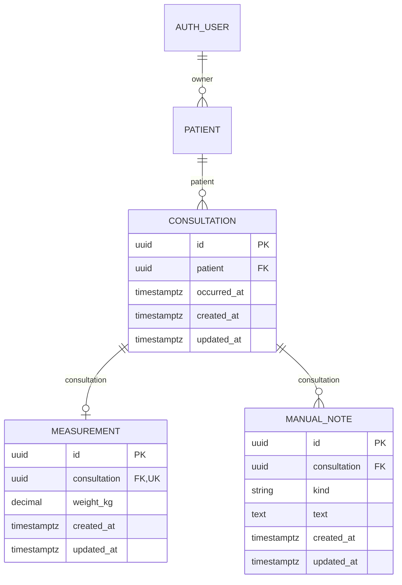

# Sprint 2: ERD propuesto, pendiente de confirmación

Leer [contrato y diccionario](S2_CONTRATO_PROPUESTO.md) antes de implementar. Nombres conceptuales; app/tablas definitivas pendientes de Fernanda. Los timestamps y campos están definidos en el diccionario.

Todas las relaciones nuevas se proponen con PROTECT. AUTH_USER conserva el tipo de PK real del modelo de usuario; no se presupone UUID. Patient conserva el esquema acordado de Sprint 1. Propiedad nueva derivada por Patient.owner, sin FK redundante al profesional.

Historial y evolución son proyecciones de estas entidades, sin tabla propia. No hay IA, diagnósticos, borrado en cascada ni una segunda inicial de Patient. La migración definitiva dependerá de la base integrada y del modelo confirmado.
